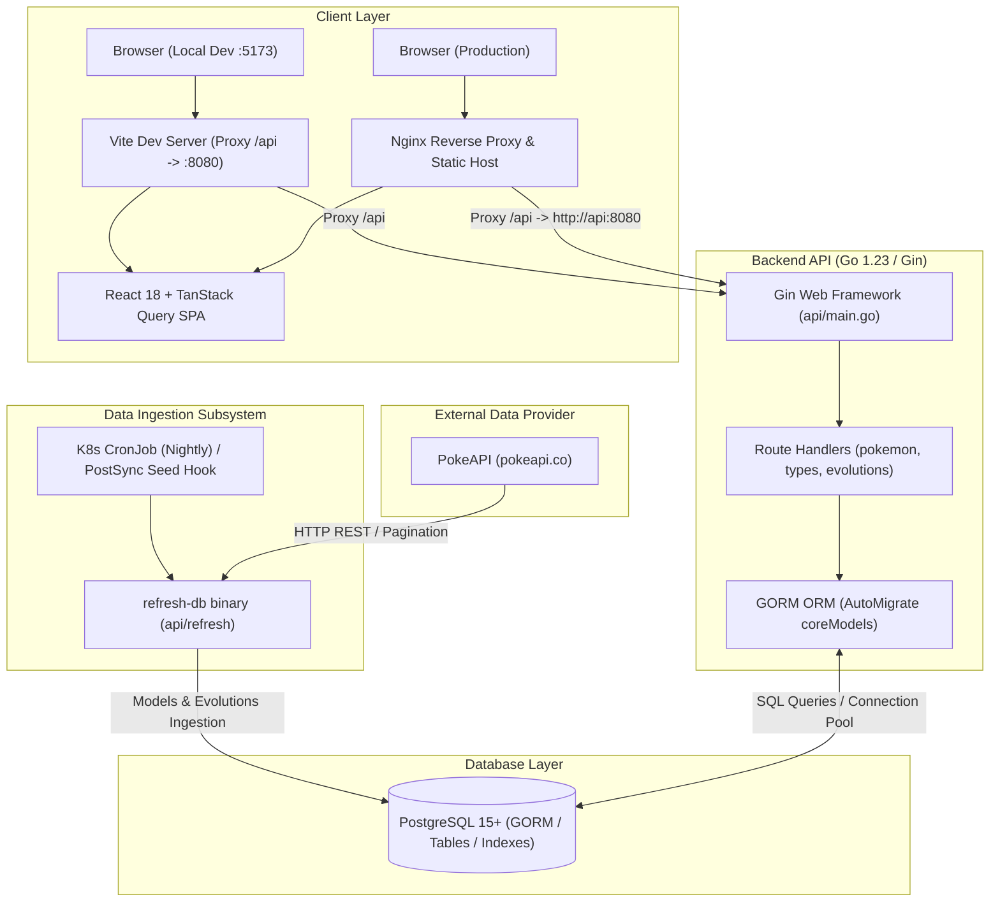
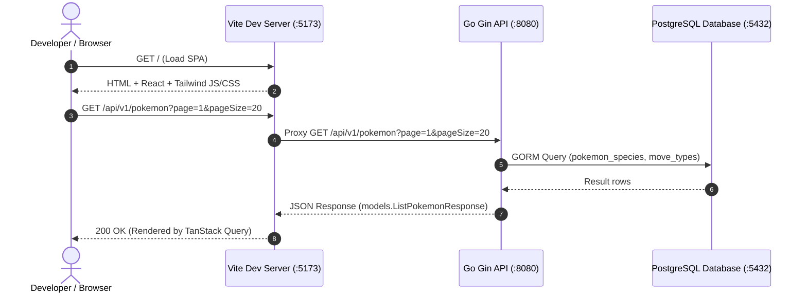
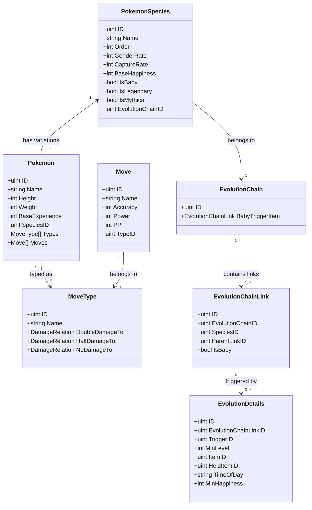
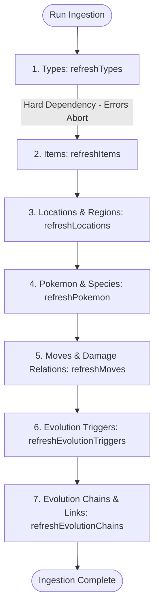
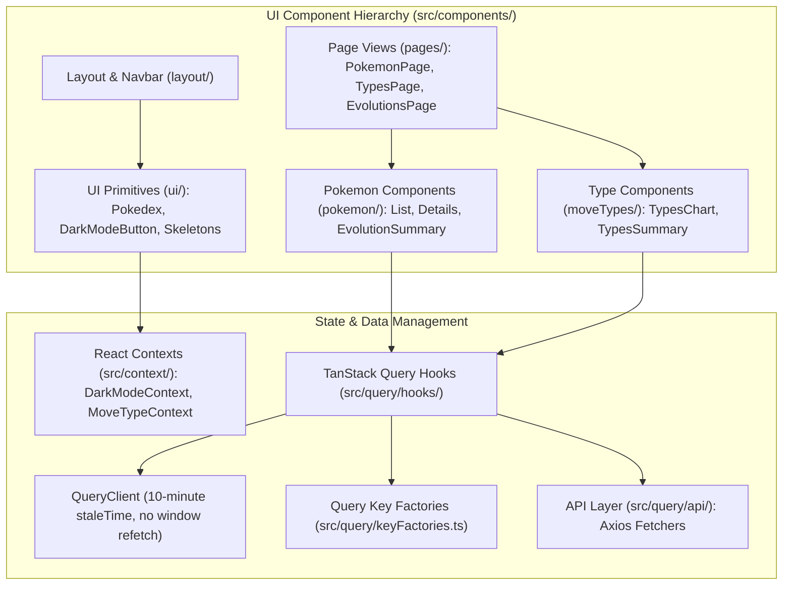
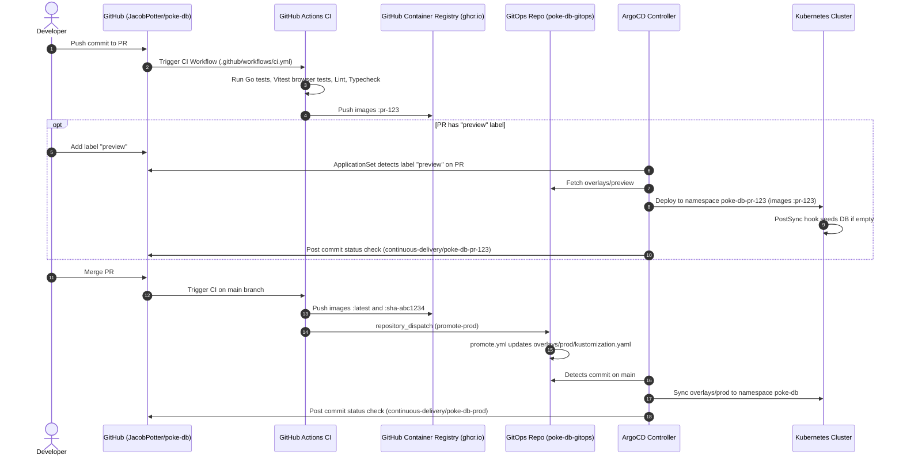

# PokeDB System Architecture

This document provides a comprehensive technical overview of the **PokeDB** system architecture, data flow, database schema & migrations, external data ingestion, and GitOps CI/CD deployment model.

---

## 1. High-Level Architecture Overview

PokeDB is an online Pokédex application composed of a Go REST API, a React Single Page Application (SPA), a PostgreSQL relational database, and an ingestion subsystem that synchronizes data from PokeAPI.

---

## 2. Request Lifecycle & Routing Across Environments

### Local Development Environment
In local development, the frontend runs via Vite's development server (`http://localhost:5173`) and the API runs on `http://localhost:8080`.
- The frontend sends API requests to `/api/v1/...`.
- Vite's proxy configuration in `frontend/vite.config.ts` intercepts `/api` and proxies the requests directly to `http://localhost:8080`.

### Production Environment (Kubernetes & Nginx)
In production container environments:
- An Nginx web server serves the compiled React static assets (`/usr/share/nginx/html`).
- The `location /api` block in `frontend/nginx.conf` proxies backend requests to the internal Kubernetes API service (`http://api:8080`).
- The trailing slash on `proxy_pass http://api:8080;` preserves route resolution under `/api/v1`.
- Direct client-side page routing (e.g. `/pokemon/charizard`, `/types`) is supported via Nginx's `try_files $uri $uri/ /index.html;` fallback.

---

## 3. Database Architecture & Split Migration Strategy

PokeDB utilizes **PostgreSQL 15+** with **GORM**. The database schema is divided into core application models and complex evolution graph models.

### Split Migration Mechanism

To decouple API startup from heavy migration logic and ensure schema stability:

1. **API Server Core Migrations (`models.ConnectDatabase()`)**:
   When the API server starts or tests connect, `models.ConnectDatabase()` executes `AutoMigrate()` **only** on core models:
   - `PokemonSpecies`
   - `Pokemon`
   - `MoveType`
   - `Item`
   - `Move`
   - `Location`
   - `Region`
   - `EvolutionTrigger`

2. **Evolution Tables & Full Migration (`models.MigrateAll()`)**:
   The evolution subsystem represents multi-branch evolution trees:
   - `EvolutionChain`
   - `EvolutionChainLink`
   - `EvolutionDetails`

   > **PostgreSQL 15+ Requirement**: `EvolutionDetails` utilizes a unique index with `NULLS NOT DISTINCT` to support flexible branching criteria while enforcing uniqueness across nullable fields.

   `models.MigrateAll()` is invoked exclusively by:
   - The standalone `refresh-db` binary (`api/cmd/refresh-db`)
   - The refresh test suite (`api/refresh/refresh-db_test.go`)
   - The ArgoCD PostSync hook (`base/refresh-db-seed-hook.yaml` in `poke-db-gitops`)

---

## 4. Ingestion Subsystem (`api/refresh`)

The data ingestion engine fetches relational entity data from PokeAPI and transforms it into PostgreSQL records.

### Execution Dependency Order

Because relational foreign keys and associations must be established accurately, `RefreshDB.Run()` executes ingestion in strict dependency order:

1. **Move Types (`refreshTypes`)**: Critical foundational dependency. If this step fails, the entire ingestion job aborts.
2. **Items (`refreshItems`)**: Evolution and held items.
3. **Locations & Regions (`refreshLocations`)**: Regional encounter areas.
4. **Pokemon & Species (`refreshPokemon`)**: Pokémon stats, base forms, types, and species data.
5. **Moves (`refreshMoves`)**: Move associations and type damage multipliers.
6. **Evolution Triggers (`refreshEvolutionTriggers`)**: Trigger mechanisms (level-up, trade, use-item, etc.).
7. **Evolution Chains (`refreshEvolutionChains`)**: Recursive evolution trees, branching links, and exact detail constraints.

---

## 5. Frontend Architecture & State Management

The frontend is built with React 18, TypeScript, Tailwind CSS, and TanStack Query.

### Caching Strategy
- **Query Cache (`src/query/queryClient.ts`)**: Configured with a default `staleTime` of 10 minutes (`1000 * 60 * 10`) and `gcTime` of 15 minutes.
- **Window Focus Refetching**: Disabled (`refetchOnWindowFocus: false`) to avoid redundant requests against static data.
- **Loaders**: `src/loaders/` provides prefetching routines for Pokémon detail and evolution chain screens.

---

## 6. CI/CD & GitOps Promotion Model

PokeDB uses GitHub Actions in this repository for continuous integration and container image publishing, combined with a dedicated GitOps repository ([`poke-db-gitops`](https://github.com/JacobPotter/poke-db-gitops)) and ArgoCD for deployments.

### Production Release Pipeline
1. Pull requests run backend and frontend test suites and publish preview container images (`ghcr.io/jacobpotter/poke-db-api:pr-<N>` and `ghcr.io/jacobpotter/poke-db-frontend:pr-<N>`).
2. When merged to `main`, CI tags images with `:latest` and `:sha-<short>`.
3. The `deploy-prod` GitHub Actions job sends a `repository_dispatch` event (`promote-prod`) with image tags and commit metadata to `JacobPotter/poke-db-gitops`.
4. The promotion workflow in `poke-db-gitops` updates `overlays/prod/kustomization.yaml` with the new short SHA tag and commits the change.
5. ArgoCD detects the change on `poke-db-gitops` `main`, synchronizes manifests, and performs a rolling update of the `poke-db` production namespace.
6. ArgoCD notifications report sync status and pod health back to GitHub commit statuses.

---

## Related Documentation

- [Project Overview & Quickstart](README.md)
- [Contributing Guidelines](CONTRIBUTING.md)
- [Backend Development Guide](api/README.md)
- [Frontend Development Guide](frontend/README.md)
- [Kubernetes & GitOps Repository](https://github.com/JacobPotter/poke-db-gitops)
